# Stellar/Soroban Integration Architecture

This document describes the complete integration between PaymentFlow and the Stellar blockchain, including sequence diagrams for all major flows, the Horizon polling design, Soroban contract interaction, and the payment data model.

> **Read-only integration.** The backend never holds or touches the school's Stellar private key. It only reads transactions from the public Horizon API, validates them, and records metadata in MongoDB.

---

## Table of Contents

- [1. Overview](#1-overview)
- [2. Happy Path: Payment Intent to On-Chain Confirmation](#2-happy-path-payment-intent-to-on-chain-confirmation)
  - [2.1 XLM Native Payment](#21-xlm-native-payment)
  - [2.2 USDC Asset Payment](#22-usdc-asset-payment)
- [3. Error Paths](#3-error-paths)
  - [3.1 Horizon Submission Failure and Retry](#31-horizon-submission-failure-and-retry)
  - [3.2 Polling Backoff on Horizon Errors](#32-polling-backoff-on-horizon-errors)
  - [3.3 Reorg and Stale Confirmation Handling](#33-reorg-and-stale-confirmation-handling)
  - [3.4 Distributed Lock Contention](#34-distributed-lock-contention)
- [4. Horizon Polling Design](#4-horizon-polling-design)
  - [4.1 Cursor Management](#41-cursor-management)
  - [4.2 Distributed Lock and Fencing Tokens](#42-distributed-lock-and-fencing-tokens)
  - [4.3 Back-off Policy](#43-back-off-policy)
  - [4.4 Rate Limiting and Budget](#44-rate-limiting-and-budget)
- [5. Soroban Contract Interaction](#5-soroban-contract-interaction)
  - [5.1 Contract Authorization Flow](#51-contract-authorization-flow)
  - [5.2 Contract Asset Validation Flow](#52-contract-asset-validation-flow)
  - [5.3 Contract Event Schema](#53-contract-event-schema)
  - [5.4 Replay Protection](#54-replay-protection)
- [6. Asset Support: XLM and USDC](#6-asset-support-xlm-and-usdc)
- [7. Data Model](#7-data-model)

---

## 1. Overview

PaymentFlow uses the Stellar Horizon REST API as the authoritative source of payment data. The backend polls school wallet accounts for new transactions, extracts the student ID from the transaction memo, validates the payment amount against the configured fee, then atomically records the payment in MongoDB and fires outbound webhooks and SSE events.

The Soroban contract layer (`backend/src/services/contract*.js`) provides the authorization rules, asset validation logic, and event schemas used both on-chain and off-chain to ensure consistent, auditable behaviour across both environments.

```
Parent Wallet ──► Stellar Network ──► School Wallet
                                           │
                                   Horizon Polling
                                           │
                                    Backend Services
                                    ┌──────┴──────┐
                                  MongoDB     Webhooks / SSE
```

---

## 2. Happy Path: Payment Intent to On-Chain Confirmation

### 2.1 XLM Native Payment

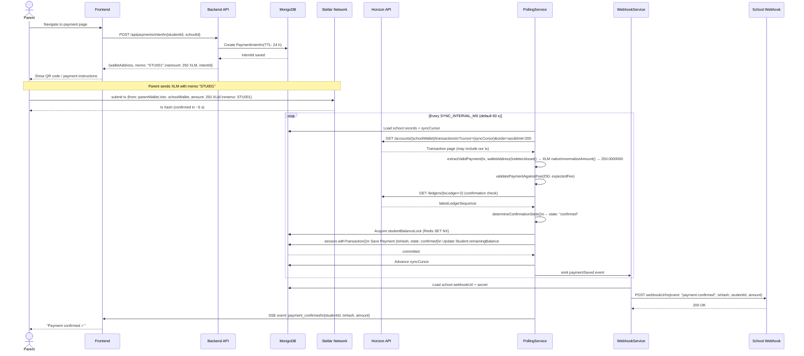

### 2.2 USDC Asset Payment

USDC payments add an issuer validation step before acceptance. The issuer address is pinned per network in `stellarConfig.js` (Circle's canonical USDC issuer on testnet/mainnet).

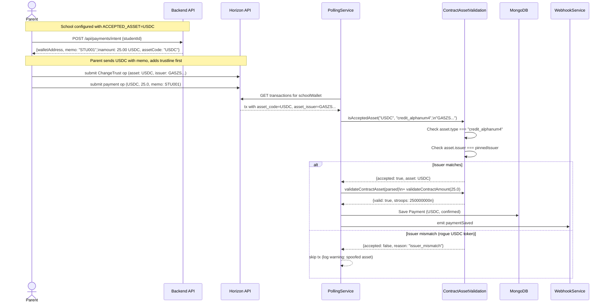

---

## 3. Error Paths

### 3.1 Horizon Submission Failure and Retry

When a payment verification fails (e.g. Horizon is unreachable, tx not found), the system enqueues a retry job with exponential backoff via BullMQ (or MongoDB fallback).

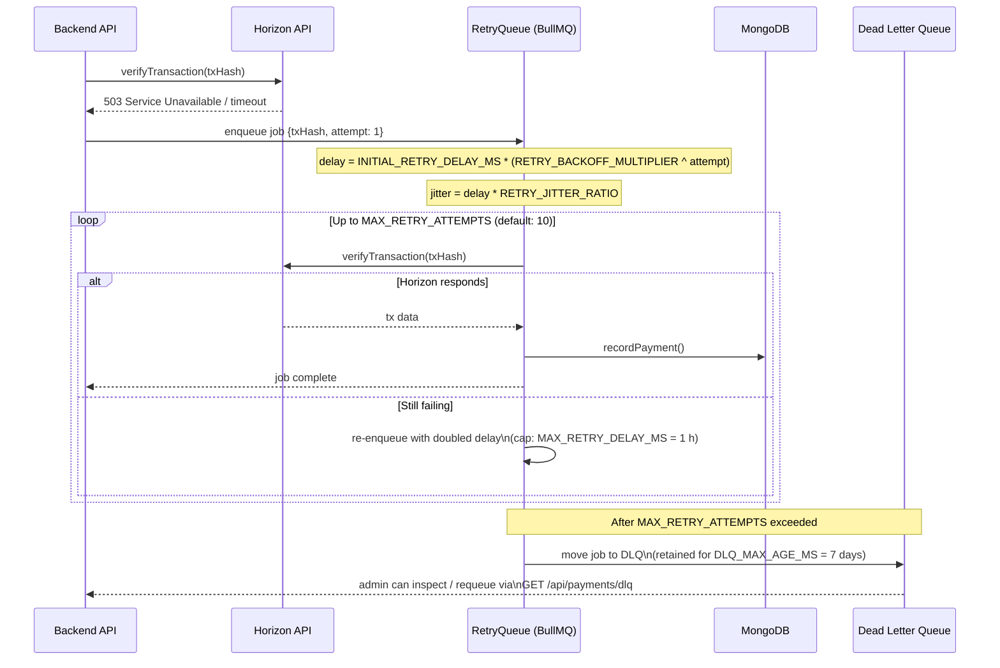

### 3.2 Polling Backoff on Horizon Errors

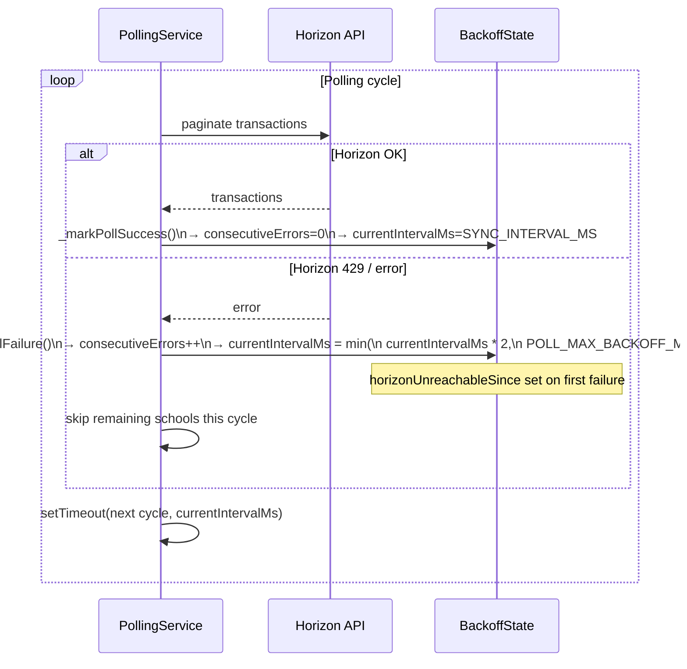

### 3.3 Reorg and Stale Confirmation Handling

Stellar has deterministic finality (no true reorgs), but the system uses a multi-stage confirmation state machine to guard against premature confirmation of transactions that are still close to the ledger tip.

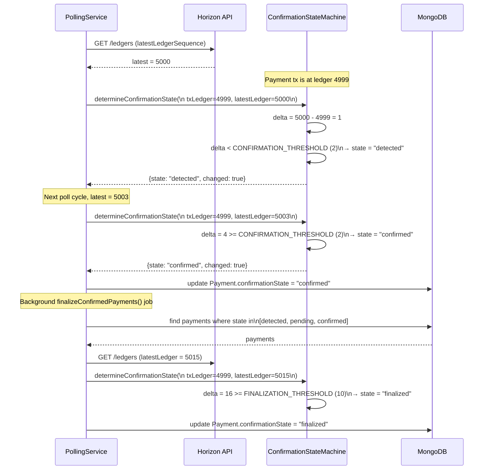

### 3.4 Distributed Lock Contention

In a horizontally-scaled deployment, multiple replicas race to poll the same school. Only one wins; the others skip the cycle without error.

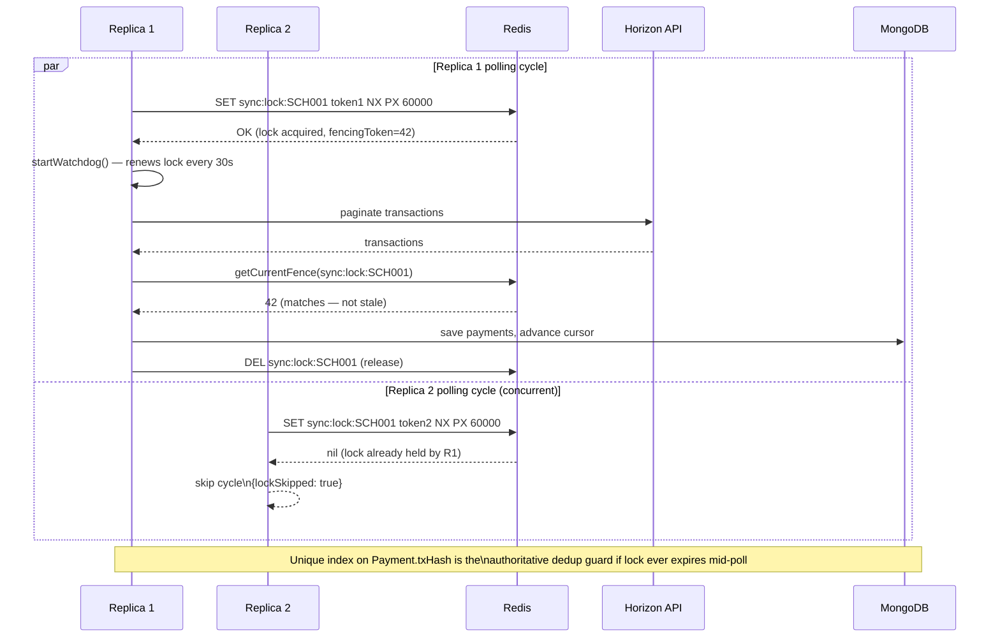

---

## 4. Horizon Polling Design

### 4.1 Cursor Management

The poller stores a `paging_token` cursor per school in MongoDB (`school.syncCursor`). On each cycle it resumes ascending from that cursor, so it never replays history from genesis and never misses transactions between cycles.

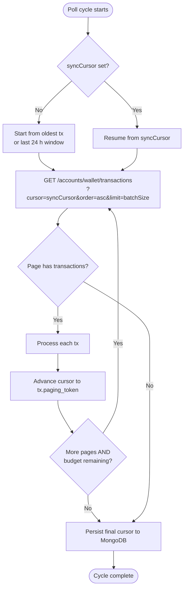

Cursor is advanced over **every** examined transaction — processed or skipped — so a gap in valid payments never stalls progress.

### 4.2 Distributed Lock and Fencing Tokens

```
Lock key:  sync:lock:{schoolId}
TTL:       SYNC_LOCK_TTL_MS (default: 60 s)
Watchdog:  renews every TTL/2 while poll is in progress
Fencing:   Redis INCR on acquire; stored with lock value;
           compared before writing to DB — stale worker writes rejected
```

The unique index on `Payment.txHash` remains the authoritative dedup guard even if a lock expires mid-poll and two workers briefly overlap.

### 4.3 Back-off Policy

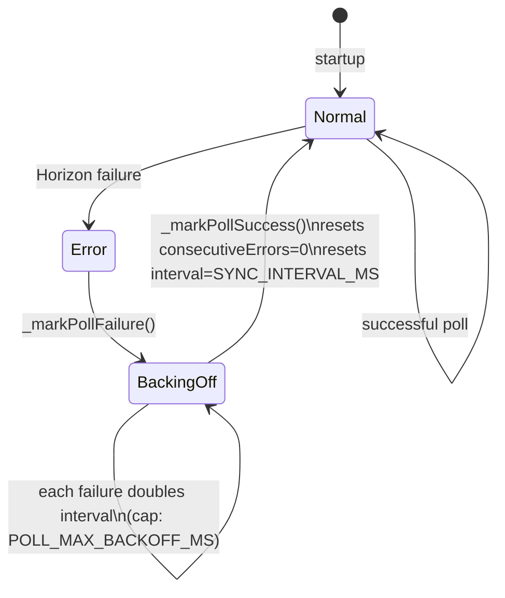

`horizonUnreachableSince` is set on the first failure in a run and cleared on recovery, allowing the system to log total outage duration.

### 4.4 Rate Limiting and Budget

Two mechanisms prevent overloading Horizon:

| Mechanism | Location | Purpose |
|-----------|----------|---------|
| `HorizonPollBudget` | `horizonPollBudget.js` | Caps total Horizon pages per interval across all schools; recalculated each cycle based on `SYNC_INTERVAL_MS` and replica count |
| `stellarRateLimitedClient` | `stellarRateLimitedClient.js` | Bottleneck queue with `STELLAR_RATE_LIMIT_MIN_TIME` spacing, `STELLAR_RATE_LIMIT_MAX_CONCURRENT` concurrency, circuit breaker via `horizonFailoverClient.js` |

Queue backpressure: if the BullMQ processing queue depth exceeds `QUEUE_BACKPRESSURE_HIGH_WATER` (default: 800 jobs), `pollSchoolTransactions` skips the cycle rather than adding more load. It resumes when depth drops below `QUEUE_BACKPRESSURE_LOW_WATER` (default: 500).

---

## 5. Soroban Contract Interaction

The contract layer (`backend/src/services/contract*.js`) mirrors the on-chain Soroban contract rules in JavaScript so the backend can validate authorizations, assets, and events without an on-chain call for every payment.

### 5.1 Contract Authorization Flow

Defined in `contractAuthorizationPolicy.js`. Five roles: `OWNER`, `OPERATOR`, `PAYER`, `BENEFICIARY`, `UNAUTHORIZED`.

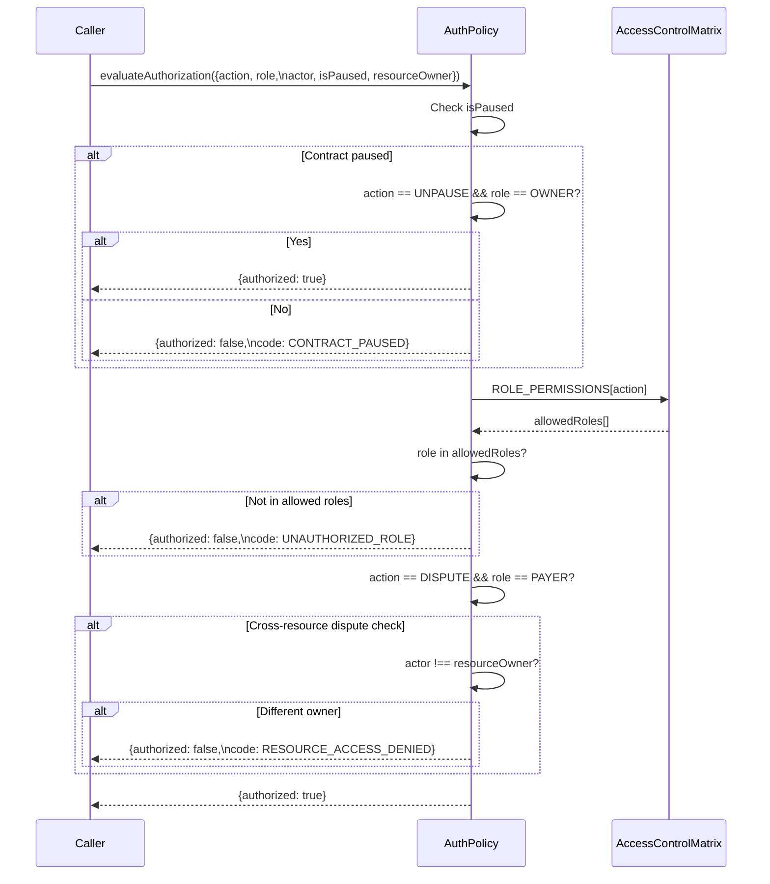

**Access control matrix summary:**

| Action | Allowed Roles |
|--------|--------------|
| `initialize` | OWNER |
| `deposit` | PAYER, OWNER |
| `release` | OPERATOR, OWNER |
| `refund` | OPERATOR, OWNER |
| `dispute` | PAYER (own resource), OPERATOR, OWNER |
| `resolveDispute` | OPERATOR, OWNER |
| `pause` | OPERATOR, OWNER |
| `unpause` | OWNER |
| `updateConfig` | OWNER |
| `rotateSigner` | OWNER |

### 5.2 Contract Asset Validation Flow

Defined in `contractAssetValidation.js`. Enforces strict issuer pinning for credit assets and exact stroop-precision decimal conversion.

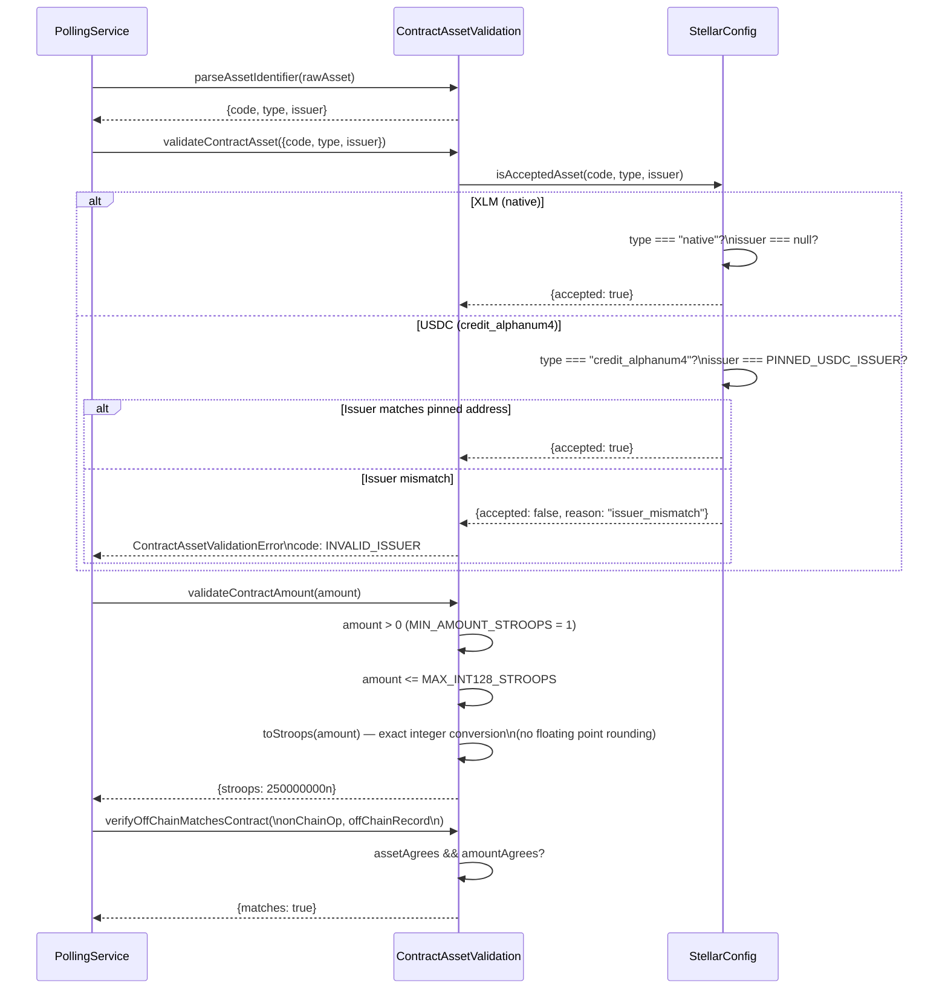

### 5.3 Contract Event Schema

Defined in `contractEventSchema.js`. All contract events share a common header plus a topic-specific payload. Events are versioned for forward/backward compatibility.

```json
{
  "eventId": "evt_01HXYZ...",
  "eventVersion": "1.0.0",
  "topic": "deposit",
  "contractId": "CCONTRACT...",
  "ledger": 5003,
  "txHash": "abc123...",
  "timestamp": "2025-01-15T10:00:00.000Z",
  "correlationId": "pay_intent_xyz",
  "payload": {
    "payer": "GPAYER...",
    "beneficiary": "GSCHOOL...",
    "assetCode": "USDC",
    "assetIssuer": "GA5ZS...",
    "amountStroops": "250000000",
    "memo": "STU001"
  }
}
```

**Idempotency:** indexers must deduplicate on `eventId`. Replaying the same event must produce identical state — `contractInstructionReplayProtection.js` enforces this by tracking processed instruction hashes.

### 5.4 Replay Protection

`contractInstructionReplayProtection.js` tracks a hash of each processed contract instruction. Re-submitting an identical instruction within the replay window returns the original result without re-executing, preventing double-spend and double-credit scenarios.

---

## 6. Asset Support: XLM and USDC

```mermaid
flowchart TD
    A([Inbound payment op]) --> B[detectAsset(payOp)]
    B --> C{asset_type?}
    C -- native --> D[XLM path]
    C -- credit_alphanum4 --> E[USDC path]
    C -- other --> F[❌ Rejected: unsupported type]

    D --> G[isAcceptedAsset\ncode=XLM, type=native, issuer=null]
    G --> H{ACCEPTED_ASSET\n== XLM?}
    H -- Yes --> I[✅ Accept XLM]
    H -- No --> J[❌ Rejected: unsupported_code]

    E --> K[isAcceptedAsset\ncode=USDC, type=credit_alphanum4,\nissuer=asset_issuer]
    K --> L{issuer matches\npinned USDC issuer?}
    L -- Yes --> M[✅ Accept USDC]
    L -- No --> N[❌ Rejected: issuer_mismatch\n(rogue token spoofing)]

    I --> O[normalizeAmount → stroops]
    M --> O
    O --> P[validatePaymentAgainstFee]
    P --> Q([Record payment])
```

Asset configuration per school is set via `ACCEPTED_ASSET` env var (default: `XLM`). Multi-asset per school is not supported in this version — one asset code per school instance.

| Asset | Type | Issuer Required | Decimals |
|-------|------|----------------|---------|
| XLM | `native` | No | 7 |
| USDC | `credit_alphanum4` | Yes (Circle canonical) | 7 |

---

## 7. Data Model

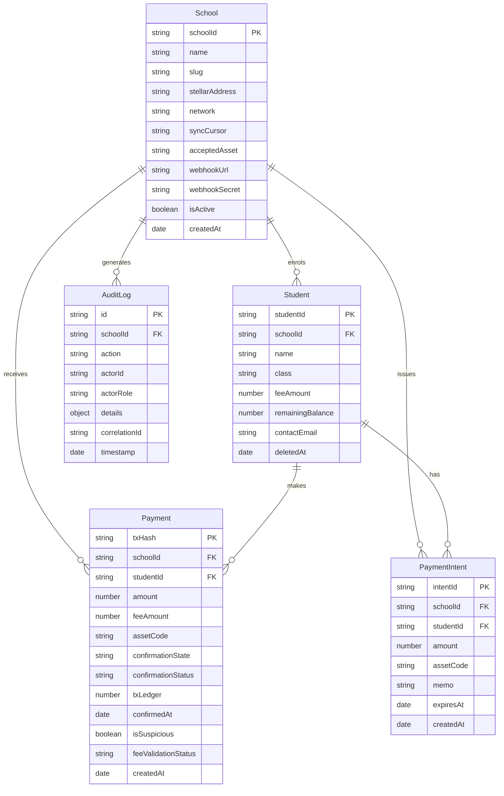

**Confirmation state transitions:**

```
detected → pending → confirmed → finalized
```

- `detected`: transaction seen on-chain, delta < `CONFIRMATION_THRESHOLD`
- `pending`: legacy alias, used by older records
- `confirmed`: delta ≥ `CONFIRMATION_THRESHOLD` (default: 2 ledgers, ~10 s)
- `finalized`: delta ≥ `FINALIZATION_THRESHOLD` (default: 10 ledgers, ~50 s)

**Key indexes:**

| Collection | Index | Purpose |
|-----------|-------|---------|
| Payment | `{txHash: 1}` unique | Dedup guard across replicas |
| Payment | `{schoolId, studentId, confirmedAt}` | Payment history queries |
| PaymentIntent | `{intentId: 1}` unique + TTL | Expire abandoned intents |
| AuditLog | `{schoolId, timestamp}` | Paginated audit queries |

---

## Related Documentation

- [`docs/stellar-integration.md`](../stellar-integration.md) — Testnet setup, memo field, fee validation, retry behaviour
- [`docs/architecture.md`](../architecture.md) — System-level component diagram and backend services overview
- [`docs/payment-lifecycle.md`](../payment-lifecycle.md) — Payment status, confirmation, retry, and reconciliation lifecycle
- [`backend/src/services/transactionPollingService.js`](../../backend/src/services/transactionPollingService.js) — Polling implementation
- [`backend/src/services/stellarService.js`](../../backend/src/services/stellarService.js) — Transaction parsing, fee validation, confirmation state machine
- [`backend/src/services/contractAuthorizationPolicy.js`](../../backend/src/services/contractAuthorizationPolicy.js) — Contract authorization rules
